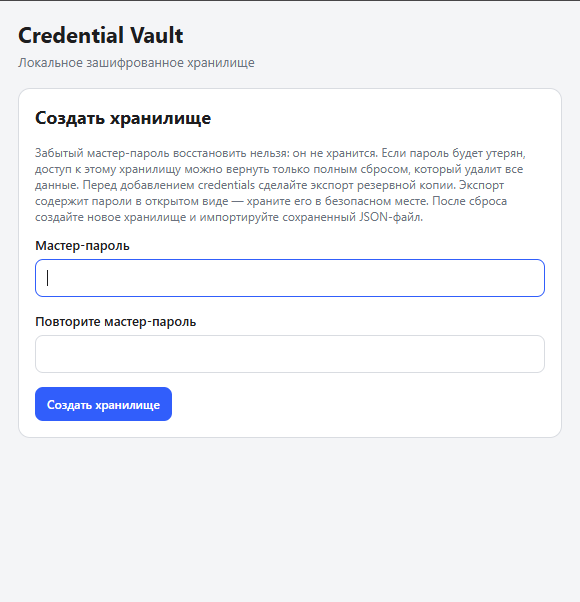
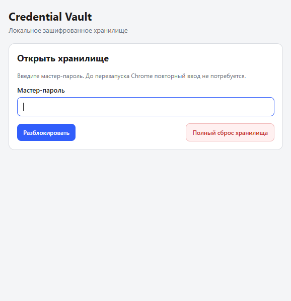
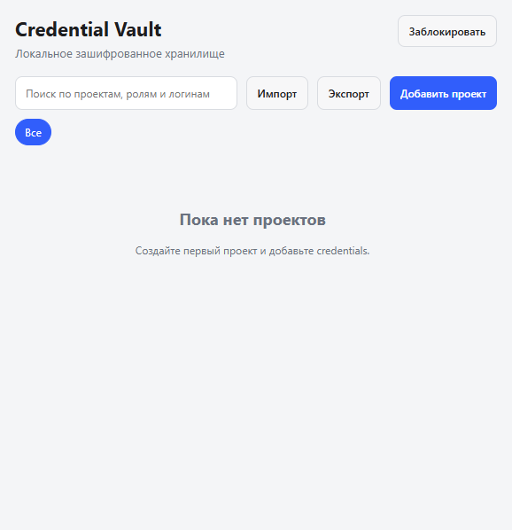
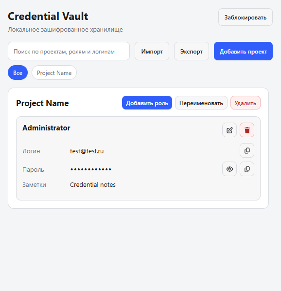
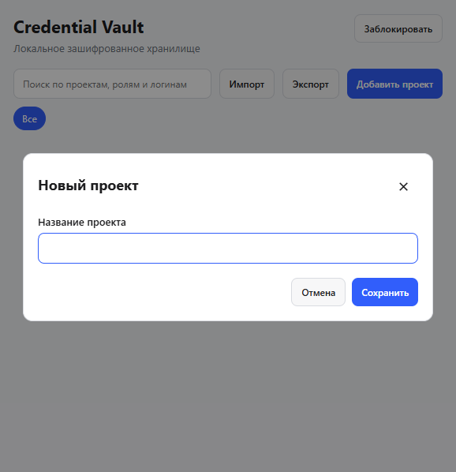
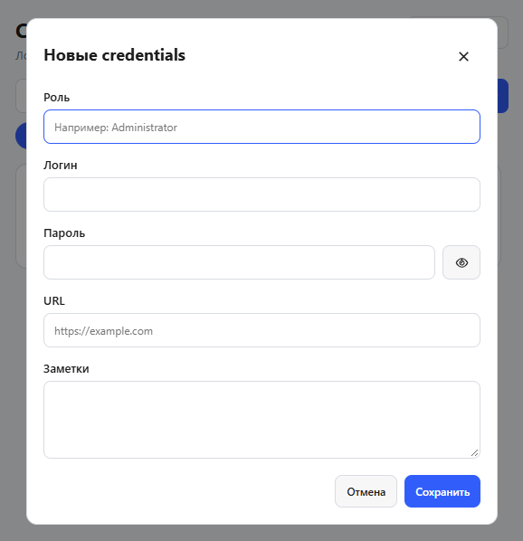

# Credential Vault

Локальное хранилище учётных данных по проектам в виде расширения Chrome. Данные в хранилище шифруются мастер-паролем; приложение работает в браузере и не использует собственный сервер.

> **Важно:** это проект для личного использования и портфолио, а не сертифицированный менеджер паролей. Перед сохранением важных данных ознакомьтесь с разделом [Безопасность и резервные копии](#безопасность-и-резервные-копии).

## Возможности

- Создание хранилища и разблокировка мастер-паролем длиной не менее 12 символов.
- Проекты с несколькими записями: роль, логин, пароль, адрес сайта и заметки.
- Шифрование содержимого с помощью AES-GCM; ключ выводится из мастер-пароля через PBKDF2.
- Автоматическое повторное открытие хранилища в течение текущей сессии Chrome.
- Поиск по проектам и учётным данным, фильтр по проектам.
- Копирование логина, пароля и адреса сайта; возможность показать пароль.
- Экспорт всех проектов и учётных данных в JSON и импорт файла того же формата.
- Полный сброс заблокированного хранилища с подтверждением.

## Скриншоты

### Создание и доступ к хранилищу

| Создание хранилища                                                         | Разблокировка и полный сброс                                     |
| -------------------------------------------------------------------------- | ---------------------------------------------------------------- |
|  |  |

### Работа с проектами и учётными данными

| Пустое хранилище                                                | Хранилище с примером проекта                                        |
| --------------------------------------------------------------- | ------------------------------------------------------------------- |
|  |  |

На скриншоте с заполненным хранилищем показаны демонстрационные данные.

### Добавление данных

| Добавление проекта                                             | Добавление учётных данных                                     |
| -------------------------------------------------------------- | ------------------------------------------------------------- |
|  |  |

## Установка

Сборка и установка зависимостей не требуются.

1. Скачайте репозиторий: нажмите **Code → Download ZIP** на GitHub и распакуйте архив либо клонируйте репозиторий.
2. Откройте `chrome://extensions` в Chrome.
3. Включите **Режим разработчика**.
4. Нажмите **Загрузить распакованное расширение** и выберите папку проекта.
5. Откройте расширение через значок на панели Chrome.

После изменений в коде нажмите кнопку перезагрузки расширения на странице `chrome://extensions`.

## Начало работы

1. При первом запуске задайте мастер-пароль не короче 12 символов и подтвердите его.
2. Создавайте проекты и добавляйте в них записи учётных данных.
3. Регулярно экспортируйте хранилище и сохраняйте резервную копию в безопасном месте.

Мастер-пароль нельзя восстановить или сбросить с сохранением данных. Если забыть пароль, единственный встроенный вариант — удалить хранилище и создать новое. После этого можно импортировать заранее сохранённый JSON-файл.

### Экспорт и импорт

**Экспорт** сохраняет все проекты и учётные данные в JSON-файл. Файл содержит логины, пароли, адреса сайтов и заметки **в открытом виде** и не защищён мастер-паролем.

**Импорт** принимает JSON, созданный функцией экспорта этого приложения. Перед сохранением проверяется формат файла. Данные добавляются к текущему хранилищу; совпадающие проекты сопоставляются по идентификатору или названию, записи с совпадающим идентификатором не перезаписываются. Повторный импорт того же файла не добавляет записи-дубликаты.

За хранение, ограничение доступа и безопасное удаление экспортных файлов отвечает пользователь. Не отправляйте их через незащищённые каналы и не оставляйте в общедоступных папках.

### Полный сброс

На экране ввода мастер-пароля нажмите **Полный сброс хранилища** и введите `СБРОС` для подтверждения. Будут удалены зашифрованное хранилище, ключ текущей сессии и сохранённое состояние интерфейса. Сброс не восстанавливает и не экспортирует данные автоматически.

Чтобы вернуть данные после сброса, сначала создайте новое хранилище с новым мастер-паролем, разблокируйте его, затем импортируйте ранее сохранённый JSON-файл.

## Безопасность и резервные копии

- Мастер-пароль не сохраняется. Если он утерян, расшифровать существующее хранилище через расширение нельзя.
- Содержимое хранилища сохраняется локально в `chrome.storage.local` в зашифрованном виде. Ключ для текущей сессии хранится в `chrome.storage.session`.
- Файл экспорта не зашифрован. Любой, кто получит его, сможет прочитать сохранённые учётные данные.
- Полный сброс необратимо удаляет текущее хранилище. Восстановление возможно только из предварительно сохранённого экспорта.
- Экспортируйте резервные копии регулярно и после важных изменений; проверяйте, что файл доступен и хранится безопасно.

Не рассматривайте это расширение как замену проверенному менеджеру паролей для критически важных учётных записей.

## Технологии

- Chrome Extension Manifest V3
- JavaScript и нативные ES-модули
- Web Crypto API: PBKDF2 и AES-GCM
- Chrome Storage API

## Структура проекта

| Файл или папка                            | Назначение                                           |
| ----------------------------------------- | ---------------------------------------------------- |
| `manifest.json`                           | Манифест расширения Chrome                           |
| `popup.html`, `popup.css`                 | Разметка и стили интерфейса                          |
| `popup.js`                                | Логика интерфейса и обработка действий               |
| `vault-storage.js`                        | Работа с зашифрованным хранилищем и ключом сессии    |
| `crypto-utils.js`                         | Получение ключа, шифрование и расшифрование          |
| `constants.js`, `state.js`, `elements.js` | Константы, состояние и ссылки на элементы интерфейса |
| `ui-state.js`, `dom.js`                   | Состояние интерфейса и DOM-помощники                 |
| `icons/`                                  | Иконки расширения                                    |

## Проверка синтаксиса

Для быстрой проверки JavaScript-файлов нужен установленный Node.js:

```powershell
node --check popup.js
node --check crypto-utils.js
node --check vault-storage.js
node --check ui-state.js
node --check dom.js
node --check elements.js
node --check state.js
node --check constants.js
```
